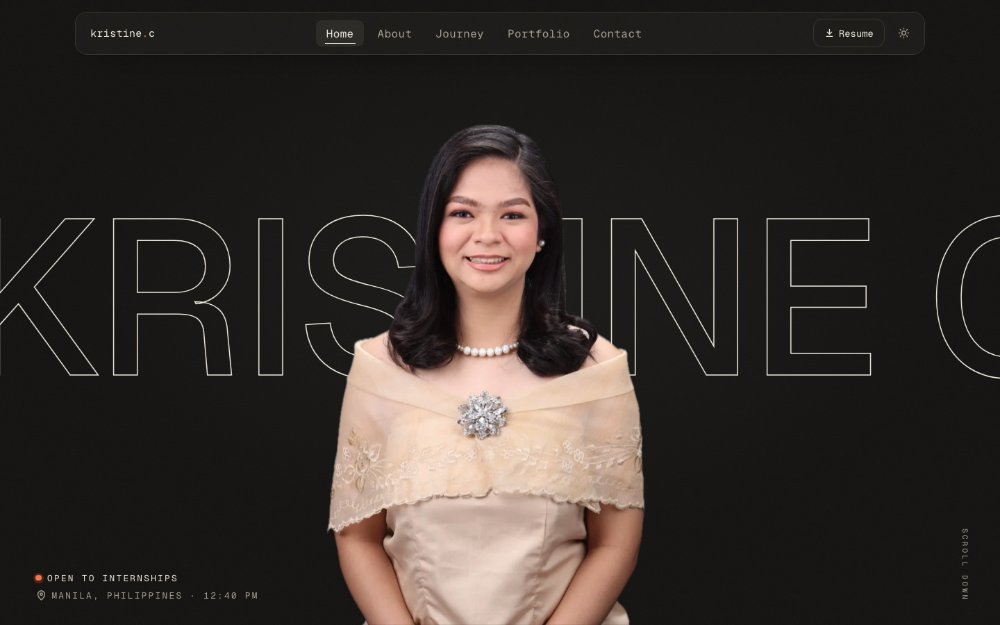

<div align="center">

# Kristine Cabanada · Portfolio

**Full-stack web developer and 4th-year BS IT student at the University of Santo Tomas**

<!-- Replace with your live link once deployed, e.g. https://kristinecabanada.vercel.app -->
[**🌐 View the live site**](#) · [**📄 Résumé**](public/Kristine-Cabanada-Resume.pdf) · [**💼 LinkedIn**](https://www.linkedin.com/in/kristine-cabanada-57a74b279/) · [**✉️ Email**](mailto:tin.cabanada@gmail.com)




</div>

## About this site

I designed and built this portfolio from scratch to show who I am, what I've built and how I work. Everything is hand-written in React and TypeScript, with no template or UI kit.

## Highlights

- **Full-screen opener.** A cut-out portrait with my name scrolling behind it, plus a live Manila clock and an "open to internships" badge.
- **Light and dark themes.** It follows your system setting, and there's a one-click toggle in the header.
- **Tabbed portfolio.** Projects, certificates and tech stack in one section, and each tab can be linked directly (`#projects`, `#certifications`, `#skills`).
- **A page for each project.** Every project has its own shareable page (e.g. `#/projects/agos`) with its stack, my role and what I built.
- **"How I Work" section.** Each strength links to the real project that proves it.
- **Résumé download** from the header, the intro, the journey section and the footer.
- **Contact form** built for Web3Forms. Until a key is added, it opens the visitor's email app instead.
- **Built for everyone.** Responsive from phones to wide screens, with a skip-to-content link, keyboard-friendly navigation and scroll-reveal animations.
- **Content kept separate from code.** All text lives in `src/data`, so I can update the site without touching any components.

## Featured projects

| Project | What it is | Stack |
|---|---|---|
| **AGOS** *(Capstone, in progress)* | An offline-first transit companion for Pasig River Ferry commuters, with live ETAs and Dijkstra-based last-mile routing | React, TypeScript, Vite, Tailwind |
| **Solteira & Brands** | QA testing for an inventory, ordering and delivery platform for a fine-jewelry retailer | ASP.NET, MySQL, Tailwind |
| **WellByte** | A wellness and time-management portal for CICS students | PHP, Firebase, Tailwind |
| **Café Alnardo** | A full-stack café ordering website with a mobile-first design | ASP.NET, MySQL, Tailwind |
| **Shelter of Light** | An awareness platform for a Quezon City animal rescue | PHP, MySQL, Tailwind |

## Tech stack

| | |
|---|---|
| **Framework** | React 19 + TypeScript |
| **Build tool** | Vite |
| **Styling** | Tailwind CSS 4 with custom theme tokens for light and dark mode |
| **Icons** | Simple Icons (tech logos) plus hand-drawn SVG icons |
| **Forms** | Web3Forms |
| **Hosting** | Vercel, which redeploys on every push to `main` |

## Run it locally

You need [Node.js](https://nodejs.org) (LTS) installed. Then run:

```bash
npm install
npm run dev      # start the dev server at http://localhost:5173
npm run build    # type-check and build for production into /dist
```

## Project structure

```
src/
├── components/   # Hero, Intro, About, Journey, Portfolio, HowIWork, Contact…
├── data/         # all site content: profile, projects, skills, certifications
└── index.css     # theme colors, fonts and animations
public/           # photos, logos and the résumé PDF
```

<details>
<summary><b>Updating the content</b></summary>

| What | File |
|---|---|
| Name, intro, links, photo, education, leadership | `src/data/profile.ts` |
| Projects | `src/data/projects.ts` |
| Skills | `src/data/skills.ts` |
| Certifications | `src/data/certifications.ts` |
| "How I Work" strengths | `src/data/strengths.ts` |
| Journey timeline | `src/data/journey.ts` |
| Résumé | `public/Kristine-Cabanada-Resume.pdf` |
| Colors and fonts | `src/index.css` |

- **Project screenshots:** add them to `public/screenshots/` (1600 × 1000) and set `image` in `projects.ts`.
- **Certificate images:** add them to `public/certificates/` and set `image` (and optionally `verifyUrl`) in `certifications.ts`.
- **Contact form:** paste a free key from [web3forms.com](https://web3forms.com) into `WEB3FORMS_ACCESS_KEY` in `profile.ts`.

</details>

---

<div align="center">

Designed and built by **Kristine Cabanada** · Manila, Philippines

</div>
